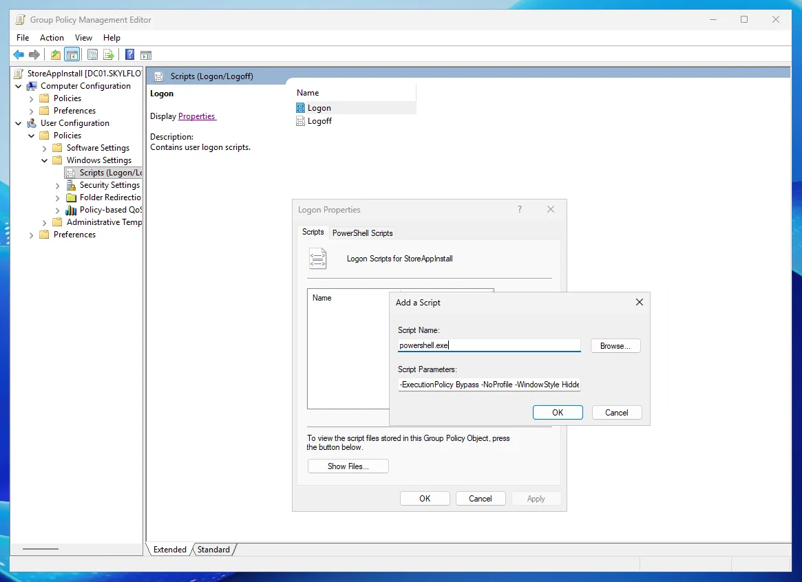

# Deploy Microsoft Store apps with Group Policy and winget

A PowerShell **user logon script** that installs Microsoft Store apps for every domain user a GPO
applies to — silently, **without Intune**, **without admin rights**, and **without ever forcing updates**.

Microsoft Store for Business is retired and the official route now runs through Intune. If your PCs are
joined to Active Directory and managed with plain Group Policy, this fills the gap.

📖 Step-by-step guide with screenshots: https://onemount.app/learn/deploy-microsoft-store-apps-gpo/

## How it works

On every logon the script:

1. **Hands off to the background.** The logon script returns in about a second and continues in a hidden
   process, so sign-in is never delayed and the Group Policy script time limit (10 minutes by default)
   can't cut it off.
2. **Checks what's installed** with a single `winget export` call (~2 s).
3. **Skips installed apps** — no reinstall, no upgrade. The Store keeps them up to date on its own.
4. **Installs what's missing** with `winget install --source msstore`, verifies it, and opens it once.
5. **Logs the result** to `%LOCALAPPDATA%\StoreAppInstall\install.log`:
   `RESULT: 2 OK, 0 FAILED, 0 POSTPONED, 0 CONFIG_ERRORS`.

No cache or marker files: what's installed is read fresh each time, so an app a user removed comes back
at the next logon, and a reimaged PC simply starts over.

## Quick start

**1. List your apps** at the top of [`StoreAppInstall.ps1`](StoreAppInstall.ps1) — one line per app.
The Store ID is the last part of the app's `apps.microsoft.com` address, or the *Id* column of
`winget search "name" --source msstore`.

```powershell
[object[]]$Apps = @(
  @{ Name = 'OneMount';  StoreId = '9P68LJCNCHND' }
  @{ Name = 'PostMount'; StoreId = '9PN0511DJX9K' }
  @{ Name = 'WhatsApp';  StoreId = '9NKSQGP7F2NH'; Launch = $false }
)
```

**2. Put it in SYSVOL** so every domain user can read it: `\\<domain>\SYSVOL\<domain>\scripts\`.
Copying straight to that network path from your own PC will most likely fail — writing to SYSVOL over
the network is restricted. On one of the domain controllers, copy it into the local folder
`C:\Windows\SYSVOL\sysvol\<domain>\scripts\` instead; it's the same folder, and Windows replicates it to
the other domain controllers.

**3. Add it to a GPO** linked to the OU with your users:
**User Configuration → Policies → Windows Settings → Scripts (Logon/Logoff) → Logon**, on the
**Scripts** tab (not *PowerShell Scripts*):

```text
Script Name:       powershell.exe
Script Parameters: -ExecutionPolicy Bypass -NoProfile -WindowStyle Hidden -File "\\<domain>\SYSVOL\<domain>\scripts\StoreAppInstall.ps1"
```



**4. Test** on one PC: `gpupdate /force`, sign out, sign in as a user from that OU.
To run it by hand without logging off: `powershell -ExecutionPolicy Bypass -File .\StoreAppInstall.ps1 -Foreground`.

## Which apps work

Check any app with `winget show --id <StoreId> --source msstore` and look at *Installer Type*.

| Tested listing | Installer type | Standard user, no admin |
|---|---|---|
| OneMount, PostMount, Telegram Desktop, WhatsApp, ChatGPT, Pinterest | `msstore` | ✅ Installs |
| Microsoft Teams, Zoom Workplace | `exe` (per-user) | ✅ Installs |
| Adobe Acrobat Reader, TeamViewer | `exe` (per-machine) | ⚠️ Needs admin (UAC prompt) |
| Microsoft 365 | not a package | ❌ Can't be installed this way |

## Troubleshooting

| In the log | What to do |
|---|---|
| `0x8A150014` No package found | The Store ID isn't an installable package — some listings (Microsoft 365) are only web pages |
| `0x800704C7` Canceled | The installer asked for admin rights; deploy that app another way |
| `0x8A15005E` certificate mismatch | Once per PC, as admin: `winget source reset --force`; otherwise check for a TLS-inspecting proxy |
| Install did not finish in 20 min | A Store download is stuck as *pending*; it's retried at the next logon |
| winget not available | Brand-new profile — App Installer registers shortly after the first logon |

## Requirements and limits

- Windows 10/11 with winget (App Installer); the Microsoft Store and the `msstore` source not blocked.
- Must run as a **user logon** script. A computer startup script runs as SYSTEM, and the Store refuses
  `msstore` installs in that context.
- Installs per user. Making an app present for every account on a PC before anyone signs in is
  provisioning (`Add-AppxProvisionedPackage`), which is a different mechanism.
- Windows PowerShell 5.1. The script is pure ASCII on purpose, so it parses correctly on any system codepage.

Tested in a lab domain with Windows 11 22H2 clients and a standard domain user: a first install takes
about 2 minutes per app (mostly the Store fetching the package), and every later logon about 4 seconds.

## About

Built and maintained by **[SkylFlow](https://onemount.app)** — we wrote it to roll out our own apps,
and they stay in the script as the working example:

- **[OneMount](https://onemount.app)** — SharePoint Online and OneDrive libraries as ordinary Windows
  drives: no sync, no local copies, Office co-authoring intact.
- **[PostMount](https://postmount.app)** — keeps scanners, printers, ERP systems and older mail apps
  working with Microsoft 365 mail after Basic Auth was switched off.

Replace them with any Store apps you need. Issues and pull requests are welcome.

## License

[MIT](LICENSE)
